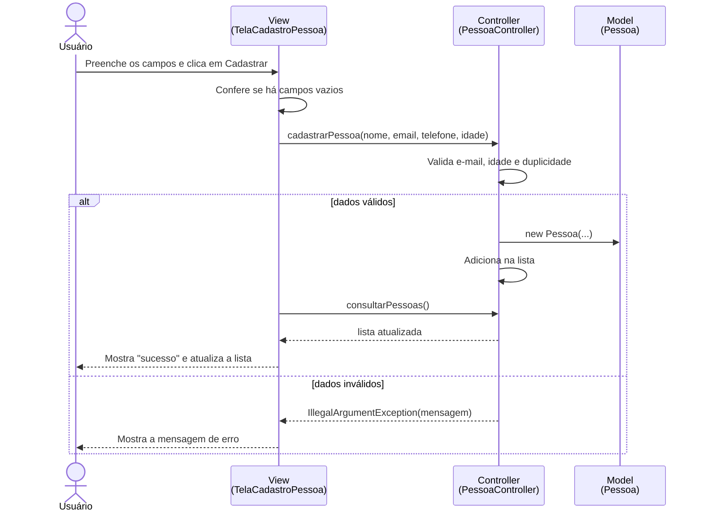
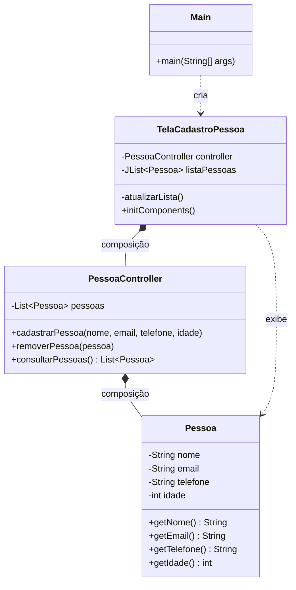

# 🧩 PROG II - Projeto MVC


Aplicação desktop de **cadastro de pessoas** em Java (Swing), usada para estudar o padrão de projeto **MVC (Model-View-Controller)**.

> 📚 **Créditos:** o código base (`Main.java` e `view/TelaCadastroPessoa.java`) foi desenvolvido pelo **professor Hugo Kuribayashi** para a disciplina de Programação II. Este repositório é uma cópia para fins de estudo, com extensões feitas por mim (listadas [mais abaixo](#-o-que-eu-adicionei)).

---

## 📑 Índice

- [O que o programa faz](#-o-que-o-programa-faz)
- [O que é MVC](#-o-que-é-mvc)
- [Estrutura do projeto](#-estrutura-do-projeto)
- [Como cada camada funciona aqui](#-como-cada-camada-funciona-aqui)
- [Fluxo de uma ação](#-fluxo-de-uma-ação)
- [Diagrama de classes](#-diagrama-de-classes)
- [Como executar](#-como-executar)
- [Conceitos que aprendi](#-conceitos-que-aprendi)
- [O que eu adicionei](#-o-que-eu-adicionei)
- [Próximos passos](#-próximos-passos)
- [Créditos](#-créditos)

---

## 🎯 O que o programa faz

| Funcionalidade | Descrição |
|---|---|
| ➕ **Cadastrar** | Registra uma pessoa com nome, e-mail, telefone e idade |
| 📋 **Listar** | Mostra todas as pessoas cadastradas ("nome - e-mail") |
| 🔍 **Ver detalhes** | Ao selecionar uma pessoa na lista, exibe todos os dados dela |
| 🗑️ **Remover** | Remove a pessoa selecionada |
| ✅ **Validar** | Rejeita e-mail inválido, idade inválida e e-mail duplicado |

> ⚠️ Os dados ficam **em memória**: ao fechar o programa, tudo é perdido.

---

## 🧠 O que é MVC

O **MVC** divide a aplicação em três camadas, cada uma com uma responsabilidade:

| Camada | Papel | Neste projeto |
|---|---|---|
| 🗃️ **Model** | Dados e regras de negócio | `Pessoa` |
| 🖼️ **View** | O que o usuário vê e com o que interage | `TelaCadastroPessoa` |
| 🎮 **Controller** | Recebe as ações da View e coordena o resto | `PessoaController` |

**Por que usar?**
- Separação de responsabilidades: cada classe tem um único motivo para mudar.
- A interface pode mudar sem reescrever a lógica.
- Regras de negócio ficam em um lugar só.
- Facilita testes e trabalho em equipe.

---

## 📂 Estrutura do projeto

```
PROGII-ProjetoMVC/
├── README.md
├── .gitignore
└── src/
    ├── Main.java                      # ponto de entrada
    ├── model/
    │   └── Pessoa.java                # entidade (dados)
    ├── controller/
    │   └── PessoaController.java      # regras de negócio e armazenamento
    └── view/
        └── TelaCadastroPessoa.java    # interface gráfica (Swing)
```

---

## 🔧 Como cada camada funciona aqui

<details>
<summary><b>🗃️ Model: <code>Pessoa</code></b></summary>

<br>

Classe simples que representa uma pessoa. Guarda quatro atributos e oferece os getters:

| Atributo | Tipo |
|---|---|
| `nome` | `String` |
| `email` | `String` |
| `telefone` | `String` |
| `idade` | `int` |

Ela **não sabe** que existe uma tela e não conhece o Controller.

</details>

<details>
<summary><b>🎮 Controller: <code>PessoaController</code></b></summary>

<br>

Guarda a lista de pessoas em memória e expõe três operações:

| Método | O que faz |
|---|---|
| `cadastrarPessoa(nome, email, telefone, idade)` | Valida os dados e adiciona a pessoa |
| `removerPessoa(pessoa)` | Remove a pessoa da lista |
| `consultarPessoas()` | Devolve uma **cópia** da lista |

**Regras de negócio** (lançam `IllegalArgumentException` com a mensagem de erro):
- o e-mail precisa conter `@`;
- a idade deve estar entre 0 e 120;
- não pode haver dois cadastros com o mesmo e-mail (sem diferenciar maiúsculas de minúsculas).

</details>

<details>
<summary><b>🖼️ View: <code>TelaCadastroPessoa</code></b></summary>

<br>

Janela Swing (`extends JFrame`) com:
- campos de texto para nome, e-mail, telefone e idade;
- botões **Cadastrar** e **Remover**;
- uma `JList` com as pessoas cadastradas;
- uma área de detalhes da pessoa selecionada.

A View **não valida regras de negócio**. Ela lê os campos, chama o Controller e exibe o resultado ou a mensagem de erro.

</details>

---

## 🔄 Fluxo de uma ação

O que acontece ao clicar em **Cadastrar**:



---

## 🗺️ Diagrama de classes



> 💡 **Composição:** a View cria o Controller (`new PessoaController()`) e o Controller cria as `Pessoa`. Se o dono deixa de existir, as partes também.

---

## ▶️ Como executar

**Requisitos:** JDK instalado (Java 8 ou superior).

<details>
<summary><b>Pelo IntelliJ IDEA</b></summary>

<br>

1. Clone o repositório e abra a pasta no IntelliJ (**File → Open**).
2. Em **File → Project Structure → Project**, escolha um JDK instalado.
3. Em **Modules**, clique com o botão direito em `src` e marque como **Sources**.
4. Execute a classe `Main`.

</details>

<details>
<summary><b>Pelo terminal (Git Bash, CMD, Linux ou Mac)</b></summary>

<br>

Na raiz do projeto:

```bash
# compilar
javac -d out src/Main.java src/model/*.java src/controller/*.java src/view/*.java

# executar
java -cp out Main
```

</details>

---

## 🎓 Conceitos que aprendi

<details>
<summary><b>Composição x agregação</b></summary>

<br>

- **Composição:** o "todo" cria e é dono das partes; sem o todo, as partes deixam de existir (losango preenchido).
- **Agregação:** as partes existem de forma independente e o "todo" só as referencia (losango vazio).

No projeto, `PessoaController` cria a lista e as `Pessoa`, então é composição. Receber as dependências de fora (*injeção de dependência*) seria agregação.

</details>

<details>
<summary><b><code>equals</code> x <code>equalsIgnoreCase</code> x <code>==</code></b></summary>

<br>

```java
"Ana@Email.com".equals("ana@email.com");            // false
"Ana@Email.com".equalsIgnoreCase("ana@email.com");  // true
```

Para comparar o **conteúdo** de `String`, nunca use `==`: ele compara se são o mesmo objeto na memória.

</details>

<details>
<summary><b><code>getValueIsAdjusting()</code></b></summary>

<br>

Em um `ListSelectionListener`, indica se a seleção ainda está mudando. Um único clique pode gerar vários eventos, e o `if (e.getValueIsAdjusting()) return;` faz o código reagir só ao evento final.

</details>

<details>
<summary><b>Por que o listener de seleção precisa tratar <code>null</code></b></summary>

<br>

O `atualizarLista()` chama `modeloLista.clear()`, que remove a seleção e dispara o listener com `getSelectedValue() == null`. Sem o `return` após limpar os detalhes, o código tentaria `p.getNome()` e lançaria `NullPointerException`.

</details>

<details>
<summary><b><code>JList</code> x <code>DefaultListModel</code></b></summary>

<br>

O Swing separa **como a lista aparece** (`JList`) do **que ela contém** (`DefaultListModel`). Para mudar o conteúdo, altera-se o modelo.

</details>

<details>
<summary><b>Ordem dos <code>catch</code></b></summary>

<br>

`NumberFormatException` é subclasse de `IllegalArgumentException`. A subclasse deve vir **antes** da superclasse, senão o compilador reclama de código inalcançável.

</details>

---

## ✨ O que eu adicionei

O código do professor tinha apenas nome e e-mail. Minhas extensões:

- [x] Criadas as classes `Pessoa` (model) e `PessoaController` (controller)
- [x] Novos campos: **telefone** e **idade**
- [x] **Detalhes** da pessoa ao selecioná-la na lista
- [x] Botão **Remover**
- [x] Regras de negócio no Controller (e-mail válido, idade válida, e-mail duplicado)
- [x] Tratamento de erros na View com `try/catch`

---

## 🚀 Próximos passos

- [ ] Botão **Editar** pessoa
- [ ] Campo de **busca/filtro** por nome
- [ ] Trocar a `JList` por uma `JTable` com colunas
- [ ] Injeção de dependência do Controller na View
- [ ] **Persistência** em arquivo (CSV ou JSON)
- [ ] Classe `PessoaDAO` para separar o acesso a dados
- [ ] Banco de dados com JDBC (SQLite)
- [ ] Testes unitários das regras do Controller

---

## 👏 Créditos

- **Código base e proposta da atividade:** Prof. Hugo Kuribayashi (Programação II).
- **Extensões, estudos e documentação:** feitos por mim, para fins de aprendizado.

> Este repositório é um material de estudo. O código base pertence ao professor e é usado aqui com fins educacionais.
